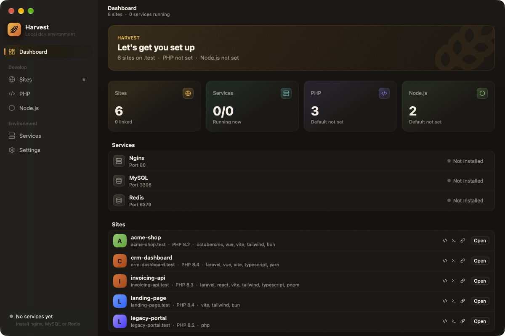
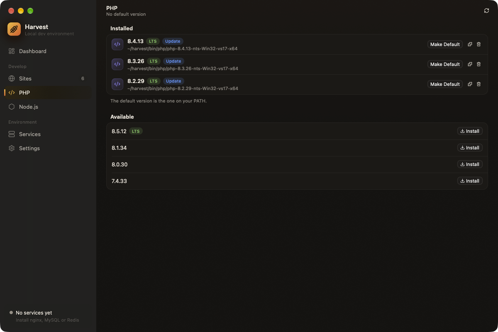

# Harvest - Local Development Environment Manager

A fully native desktop application for managing local PHP/Node.js development environments on Windows. Built in Rust with a GPUI UI (no webview).





## Tech Stack

- **UI:** GPUI (Zed's GPU-accelerated UI framework) via [gpui-kit](https://gpui-kit.com), which pins a GPUI snapshot and bundles gpui-component
- **Backend:** `harvest-core` (plain Rust, no UI dependencies)
- **Async:** tokio for core work, awaited from GPUI tasks on the UI thread
- **Tray:** `tray-icon`, with a status-aware icon drawn by resvg
- **Theme:** warm darks with a wheat gold to pumpkin brand gradient; system font (SF Pro / Segoe UI)

Single language end to end, native rendering, no bundled webview, no CDN fonts.

---

## Feature Checklist

### Core Infrastructure
- [x] Native Rust + GPUI app (no webview)
- [x] Branded dark theme (wheat gold to pumpkin gradient, warm surfaces)
- [x] macOS-style window: unified toolbar, translucent sidebar, inset grouped lists
- [x] Blurred window background on macOS, Mica on Windows 11
- [x] Sidebar navigation with counts and live service status
- [x] System tray icon that shows service status, with a popup to toggle services

### PHP Management
- [x] Fetch available PHP versions from windows.php.net
- [x] Show supported/LTS versions from php.net/releases/active
- [x] Download and install PHP versions
- [x] Uninstall PHP versions
- [x] Grouped version display (multiple versions per major.minor)
- [x] Update detection (show when newer version available)
- [x] PHP extensions management (enable/disable via php.ini)
- [x] Version caching (24h TTL) with manual refresh button
- [ ] Per-site PHP version switching
- [x] Add PHP to Windows PATH

### Node.js Management
- [x] Fetch available Node.js versions from nodejs.org
- [x] Show LTS versions
- [x] Download and install Node.js versions
- [x] Uninstall Node.js versions
- [x] Update detection
- [x] Package managers detection (npm, yarn, pnpm, bun)
- [x] Grouped version display (like PHP)
- [x] Version caching (24h TTL) with manual refresh button
- [x] Add Node to Windows PATH

### Site Management
- [x] Scan directories for projects
- [x] Display site list with framework detection
- [x] Open site in browser
- [x] Open site in editor (VS Code, Cursor, PhpStorm)
- [x] Open site in terminal
- [x] Auto-detect OctoberCMS, Laravel, vanilla PHP
- [x] Create `.test` domain routing (nginx vhost + hosts file)
- [x] Link/unlink sites UI
- [ ] Per-site PHP version pinning
- [ ] SSL certificate generation

### Service Management
- [x] Services view UI
- [x] Start/stop nginx
- [x] Start/stop MySQL
- [x] Start/stop Redis
- [x] Status monitoring (running/stopped)
- [x] Version detection
- [ ] Start/stop PHP-FPM
- [ ] Auto-start on app launch
- [ ] View service logs

### Settings
- [x] Sites directory configuration
- [x] Editor selection (code, cursor, phpstorm)
- [x] Terminal selection
- [ ] Auto-start services toggle
- [ ] Theme selection (dark/light)

### System Integration
- [x] Configuration persistence (JSON file)
- [x] Cross-platform path handling (Windows/macOS/Linux)
- [x] System tray icon + popup (toggle, hide-on-blur, quick actions)
- [ ] Minimize to tray
- [ ] SQLite database for config
- [ ] Windows startup option
- [ ] Auto-updater

### Harvest Standalone Structure
- [x] `C:\harvest\bin\` - Service binaries (nginx, mysql, redis, php)
- [x] `C:\harvest\etc\` - Config files (nginx.conf, vhosts, ssl)
- [x] `C:\harvest\logs\` - Service logs
- [x] Configurable harvest home path
- [x] First-run setup wizard

---

## Project Structure

Cargo workspace:

```
harvest/
├── Cargo.toml                    # workspace (default-members = harvest-gpui)
├── crates/
│   ├── harvest-core/             # backend logic, no UI deps
│   │   ├── src/
│   │   │   ├── lib.rs
│   │   │   ├── config.rs         # config + Windows PATH management
│   │   │   ├── sites.rs          # site scanning, detection, open actions
│   │   │   ├── php.rs            # PHP versions + extensions
│   │   │   ├── node.rs           # Node.js versions + package managers
│   │   │   ├── services.rs       # nginx/MySQL/Redis management
│   │   │   ├── vhosts.rs         # vhost + hosts file management
│   │   │   ├── versions.rs       # installed/available version grouping
│   │   │   ├── types.rs          # shared data structures
│   │   │   └── progress.rs       # transport-agnostic install progress
│   │   └── tests/                # unit tests for pure helpers
│   ├── harvest-gpui/             # native GPUI binary (`harvest`)
│   │   └── src/
│   │       ├── main.rs           # window setup, store, tray
│   │       ├── store.rs          # app state + every action (Store entity)
│   │       ├── bridge.rs         # tokio runtime for harvest-core calls
│   │       ├── app.rs            # toolbar, sidebar, page switch, overlays
│   │       ├── dashboard.rs      # pages: dashboard, sites, PHP/Node.js,
│   │       ├── sites.rs          #   services, settings
│   │       ├── versions.rs
│   │       ├── services.rs
│   │       ├── settings.rs
│   │       ├── extensions.rs     # PHP extensions sheet
│   │       ├── wizard.rs         # first-run setup
│   │       ├── tray.rs           # tray icon + popup
│   │       ├── theme.rs          # brand tokens + type scale
│   │       ├── ui.rs             # shared building blocks
│   │       └── assets.rs         # icons + rendered brand/tray icons
│   └── harvest-app/              # legacy Slint UI (kept until GPUI is verified on Windows)
└── README.md
```

---

## Backend API (`harvest-core`)

Plain Rust functions (no UI framework). The GPUI `Store` calls these on a tokio runtime;
installs report progress via a `ProgressSink` callback.

### Config (`config.rs`)
```rust
get_config() -> AppConfig
save_config(config: AppConfig) -> Result<(), String>
is_first_run() -> bool
get_harvest_home() -> String
initialize_harvest_home(path: String) -> Result<(), String>
validate_harvest_path(path: String) -> Result<bool, String>
// PATH Management
is_in_path(path: String) -> bool
add_to_path(path: String) -> Result<(), String>
remove_from_path(path: String) -> Result<(), String>
get_default_php_path() -> Option<String>
get_default_node_path() -> Option<String>
```

### Sites (`sites.rs`)
```rust
scan_sites(directories: Vec<String>) -> Result<Vec<Site>, String>
open_in_editor(path: String, editor: String) -> Result<(), String>
open_in_terminal(path: String, terminal: String) -> Result<(), String>
open_in_browser(url: String) -> Result<(), String>
```

### PHP (`php.rs`)
```rust
get_available_php_versions(force_refresh: Option<bool>) -> Result<Vec<AvailableVersion>, String>
get_installed_php_versions() -> Vec<InstalledVersion>
install_php_version(version: String, progress: ProgressSink) -> Result<(), String>
uninstall_php_version(version: String) -> Result<(), String>
get_php_extensions(php_path: String) -> Result<Vec<PhpExtension>, String>
toggle_php_extension(php_path: String, extension: String, enable: bool) -> Result<(), String>
```

### Node.js (`node.rs`)
```rust
get_available_node_versions(force_refresh: Option<bool>) -> Result<Vec<AvailableVersion>, String>
get_installed_node_versions() -> Vec<InstalledVersion>
install_node_version(version: String, progress: ProgressSink) -> Result<(), String>
uninstall_node_version(version: String) -> Result<(), String>
get_package_managers() -> Vec<PackageManager>
```

### Services (`services.rs`)
```rust
get_services() -> Vec<ServiceInfo>
start_service(id: String) -> Result<(), String>
stop_service(id: String) -> Result<(), String>
restart_service(id: String) -> Result<(), String>
get_installable_services() -> Vec<InstallableService>
install_service(service_id: String, version: String, progress: ProgressSink) -> Result<(), String>
uninstall_service(service_id: String) -> Result<(), String>
```

### Vhosts (`vhosts.rs`)
```rust
get_vhost_status(site_name: String) -> VhostStatus
get_all_vhost_statuses(site_names: Vec<String>) -> Vec<VhostStatus>
link_site(site_name: String, root_path: String) -> Result<String, String>
unlink_site(site_name: String) -> Result<String, String>
check_nginx_config() -> Result<String, String>
```

---

## Development

```bash
# Run the app (default workspace member is harvest-gpui, binary `harvest`)
cargo run

# Build the whole workspace
cargo build

# Release build (single native binary, no webview)
cargo build --release

# Type/UI check only the backend
cargo build -p harvest-core
```

GPUI needs the latest stable Rust. On macOS it renders with Metal (install Xcode); on Windows
install Visual Studio Build Tools with "Desktop development with C++".

## Testing

```bash
# Backend unit tests (pure logic: version parsing/compare, PATH ops,
# stack/version extraction, hosts/nginx helpers)
cargo test -p harvest-core
```

```bash
# UI crate tests (brand and tray icon rendering)
cargo test -p harvest-gpui
```

Backend tests live in `crates/harvest-core/tests/`. No system libraries are
required to build/test `harvest-core`.

---

## Design Theme

Harvest's own brand on a macOS-style layout. Tokens live in `crates/harvest-gpui/src/theme.rs`.

| Token | Value | Use |
| --- | --- | --- |
| Brand gradient | `#f5b83d` to `#ef6f2e` | logo, selection, primary buttons, progress |
| Content | `#15120f` | page background (with a faint warm glow at the top) |
| Card | `#1e1a16` | inset grouped lists, tiles |
| Sidebar | `#0f0d0b` | over the window blur (macOS) or Mica (Windows) |
| Text | `#f6efe6` | cream; secondary 58%, tertiary 34% |
| Leaf | `#7bcf6b` | running, success |
| Violet / Teal / Sky | `#9d8cff` / `#3cc9b8` / `#5b9dff` | PHP / services / info |
| Rose | `#f2667a` | errors |

**Type:** system font (SF Pro on macOS, Segoe UI on Windows) at SF sizes: 13 body, 11 caption,
15 title, 20 hero title.

---

## Roadmap

### Phase 1 (Complete) - Version Management
- [x] PHP version management
- [x] Node.js version management
- [x] Package managers detection
- [x] Basic site scanning

### Phase 2 (Complete) - Service Management
- [x] Standalone `C:\harvest` folder structure
- [x] nginx, MySQL, Redis service detection
- [x] Start/stop/restart services
- [x] Service status monitoring
- [x] Version detection for services

### Phase 3 (In Progress) - Domain Routing
- [x] Nginx vhost config generation
- [x] Hosts file management (with UAC elevation)
- [x] Site link/unlink UI
- [ ] SSL certificate generation (self-signed with local CA)
- [ ] Per-site PHP version switching

### Phase 4 (Complete) - Standalone Mode
- [x] Configurable Harvest home path (e.g., `D:\Harvest`, `C:\Dev\Harvest`)
- [x] First-run setup wizard to pick install location
- [x] Small config in AppData pointing to real Harvest folder
- [x] Fully portable - move the whole folder anywhere
- [x] **Download services from official sources:**
  - [x] nginx (from nginx.org)
  - [x] MySQL (from dev.mysql.com)
  - [x] Redis (from GitHub releases)
  - [x] PHP versions (already implemented)
- [x] Service install/uninstall UI (like PHP versions page)
- [x] Completely standalone - no external dependencies

### Phase 5 - Dashboard & Polish
- [x] Quick stats overview (sites count, services status)
- [x] Services compact status cards with toggle
- [x] Recent sites quick access
- [x] System tray integration (status icon, service toggles)
- [ ] Auto-updates
- [ ] Backup/restore settings

### Future Ideas

**Database Management**
- [ ] Create/drop MySQL databases
- [ ] Database GUI (like TablePlus/HeidiSQL embedded)
- [ ] Import/export SQL dumps
- [ ] Database backups scheduling

**Developer Tools**
- [ ] Log viewer for nginx/PHP/MySQL (tail -f style)
- [ ] PHP error log viewer with syntax highlighting
- [ ] Composer integration (install, update, require)
- [ ] Artisan command runner for Laravel
- [ ] October CMS artisan commands

**Site Features**
- [ ] Site templates (create new Laravel, October, vanilla PHP)
- [ ] Clone site from Git repository
- [ ] Site backups (files + database)
- [ ] Favorite/pin sites to top
- [ ] Site groups/folders
- [ ] Site notes/descriptions

**Sharing & Collaboration**
- [ ] Share sites via tunneling (like Expose/ngrok)
- [ ] QR code for mobile testing
- [ ] Local network sharing (access from phone)

**Quality of Life**
- [ ] Global search (sites, services, settings)
- [ ] Keyboard shortcuts
- [ ] Command palette (Ctrl+K)
- [ ] Notifications for service crashes
- [ ] Health checks (disk space, memory)
- [ ] Dark/light theme toggle

**Advanced**
- [ ] Multiple PHP-FPM pools
- [ ] Xdebug configuration per site
- [ ] Mail catcher (like Mailhog/Mailpit)
- [ ] Queue worker management (Laravel Horizon)
- [ ] Cron job scheduler
- [ ] Docker integration (optional)
